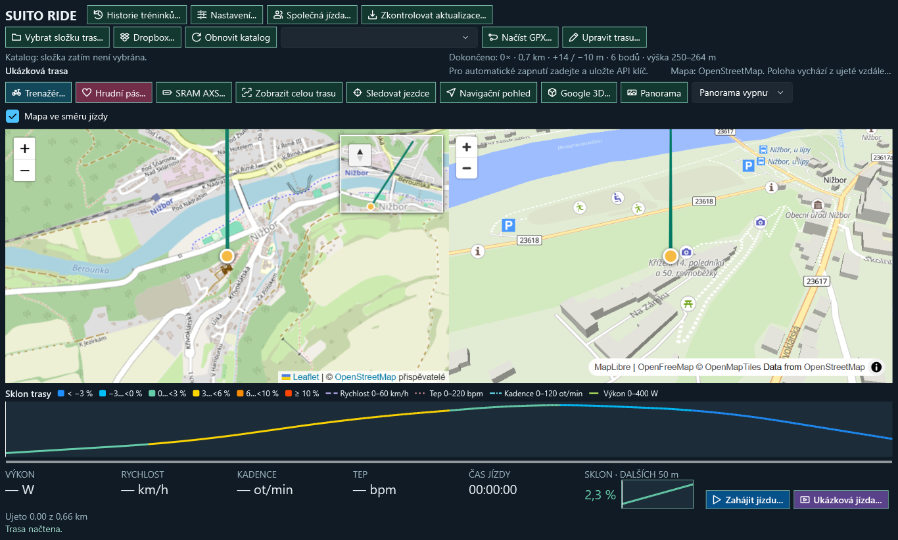

# Suito Ride

Suito Ride je aplikace pro Windows pro jízdu po GPX trase na chytrém cyklotrenažéru s Bluetooth FTMS, například Elite Suito. Zobrazuje polohu, rychlost, výkon, kadenci a výškový profil. Při skutečné jízdě upravuje odpor podle sklonu trasy.

## Stažení a první jízda

1. Na stránce [Releases](https://github.com/Pazout/SuitoRide/releases/latest) stáhni ZIP pro Windows x64, rozbal celý obsah do jedné složky a spusť SuitoRide.exe. ZIP obsahuje potřebný .NET runtime. Pro mapy je potřeba Microsoft Edge WebView2 Runtime a připojení k internetu.
2. Načti GPX s nadmořskou výškou u každého bodu a jedním souvislým úsekem. Pro vyzkoušení je v repozitáři ukazka.gpx. Katalog zobrazuje trasy z vybrané složky a počty jejich dokončení. GPX se načte hned po výběru v katalogu. Poslední použitý GPX se při spuštění obnoví, pokud je soubor stále dostupný.
3. Ukázkovou jízdu můžeš spustit bez trenažéru. Pro skutečnou jízdu zapni Bluetooth a v dialogu **Trenažér** vyhledej a připoj vybrané zařízení. Aplikace si zapamatuje poslední úspěšně připojený trenažér a při příštím spuštění ho zkusí vyhledat a připojit.
4. Ukázková jízda začíná odpočtem 3–2–1, skutečná má deset sekund. Odpočet lze zrušit klávesou Escape nebo tlačítkem v okně.

## Mapy a trasy

Základní mapa a navigační pohled MapLibre fungují bez klíče. Navigace se otáčí ve směru jízdy a sleduje polohu jezdce. Volitelně lze zadat vlastní klíč pro statická panoramata Mapy.com, Google Street View (Maps Embed API) nebo Google 3D (Maps JavaScript API). Při zapnutí Google 3D se vlevo zobrazí přehled celé trasy a ve 3D pohledu je vidět ikona silničního cyklisty. Klíče všech tří služeb najdeš v Nastavení. Poskytovatele panoramatu lze změnit u mapy i během jízdy. V Nastavení lze také upravit rozestup panoramat od 10 m (výchozí je 20 m), zobrazit velikost diskové mezipaměti a vyčistit ji.

Na výškovém profilu lze vybrat nový začátek a cíl, obrátit směr a uložit vybraný úsek jako nový GPX. Aplikace ukazuje celkové stoupání i klesání a náhled na příštích 50 metrů. Kliknutím na náhled můžeš postupně přepnout dosah na 100, 150, 250 a 500 m. Velký graf při jízdě ukazuje rychlost, tep, kadenci a výkon. Ujetá vzdálenost vychází z rychlosti hlášené trenažérem. Přesnost sklonu závisí na výškových údajích GPX.

## Referenční jízda

Nejprve načti GPX. Tlačítkem **Referenční jízda…** vyber z historie jízdu s GPS záznamem nebo načti TCX s časovými značkami a GPS body. Záznam musí pokrývat stejnou trasu či úsek ve stejném směru. Jízda s referencí začíná od startu GPX. Během jízdy údaj **s napřed** nebo **s pozadu** porovnává časy na stejném místě a fialová značka ukazuje, kde by soupeř byl ve stejném čase. Pauzy z referenčního záznamu se započítávají.

## Hrudní pás a elektronické řazení

Přes **Hrudní pás** připojíš snímač s Bluetooth LE Heart Rate Service. Aktuální tep je vidět v přehledu jízdy. Naměřené hodnoty se ukládají do historie skutečné jízdy a do exportu TCX, který aplikace používá i při odesílání na Stravu a přes FitnessSyncer. Poslední úspěšně připojený pás si aplikace zapamatuje. Při příštím spuštění aplikace se pokusí pás vyhledat a připojit. Automatické vyhledávání pásu i trenažéru běží nejvýš pět minut. Ruční vyhledání nebo připojení zruší automatický pokus pro dané zařízení jen v aktuálním spuštění aplikace.

V dialogu **SRAM AXS…** vyber přehazovačku a probuď ji krátkým stiskem AXS. Po připojení uvidíš baterii a na ověřeném modelu Force AXS také živý zadní převod. Číslo zůstává viditelné během jízdy. Výběr zařízení se obnoví při příštím spuštění. Pokud použiješ samostatné párování převodu, Windows uloží klíč chráněný pod tvým účtem.

## Dropbox

Tlačítko **Dropbox** u katalogu tras umožňuje vybrat místní složku s GPX a samostatnou složku pro automatické ukládání TCX. Po uložení skutečné jízdy do historie se její TCX zkopíruje do zvoleného umístění. Synchronizaci na účet provádí aplikace Dropbox ve Windows.

## Historie a sdílení

Skutečné jízdy se ukládají do historie. Vybranou jízdu lze exportovat jako TCX nebo ručně odeslat na Stravu, do FitnessSynceru nebo na Intervals.icu. FitnessSyncer ji může předat do Suunto, pokud je tento cíl v účtu nastavený. Ukázkové jízdy se do historie neukládají.

Před odesláním na Stravu nebo Intervals.icu lze upravit název a přidat popis. Pro Intervals.icu otevři v historii **Nastavit Intervals.icu** a zadej osobní API klíč ze sekce **Developer Settings** ve svém [účtu Intervals.icu](https://intervals.icu/settings). Potom vyber jízdu a klikni na **Odeslat na Intervals.icu**. Nově nahranou aktivitu aplikace označí jako virtuální jízdu.

Pro společnou jízdu použijte shodnou GPX trasu včetně směru a vybraného úseku. Hostitel může použít přiložený server na portu TCP 5077 v důvěryhodné místní nebo soukromé VPN síti. Ostatní zadají jeho adresu a kód místnosti. Každý jezdec spouští a ovládá vlastní jízdu; v aplikaci vidíte vzájemnou polohu.

## Nastavení a vývoj

Tlačítko **Zkontrolovat aktualizace** nabídne novější veřejný balíček z GitHubu. Ve společné instalaci ve složce `Program Files\SuitoRide` se aplikace aktualizuje na místě po potvrzení správcem a zástupce ve Startu dál funguje. Osobní aktualizace se ukládají do `%LOCALAPPDATA%\SuitoRide\installed`. Nastavení, historie a webová data jsou v adresáři `%LOCALAPPDATA%\SuitoRide` pro každý účet Windows. Klíče a přístupové tokeny se ukládají zašifrované pro aktuální účet Windows.

Výchozí jazyk vychází z regionálního formátu Windows. V Nastavení lze ručně vybrat češtinu, angličtinu, němčinu, francouzštinu, španělštinu, japonštinu, polštinu nebo slovenštinu. Ruční volba se použije při příštím spuštění; pro nepodporované regionální formáty se používá angličtina.

Pro vlastní sestavení spusť Sestavit.ps1 s .NET 10 SDK. Aplikace a server se sestaví do složky app. Před sestavením zavři běžící aplikaci.
